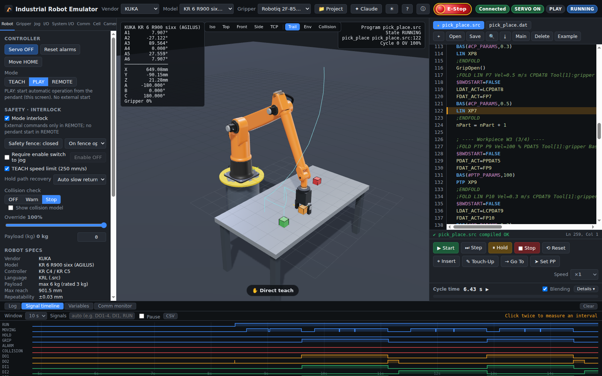
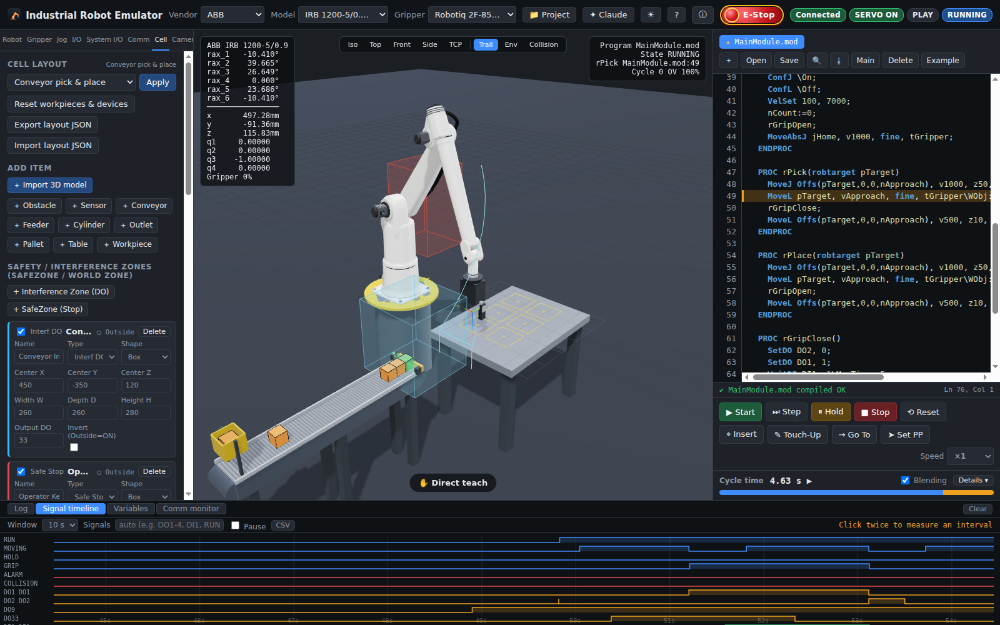
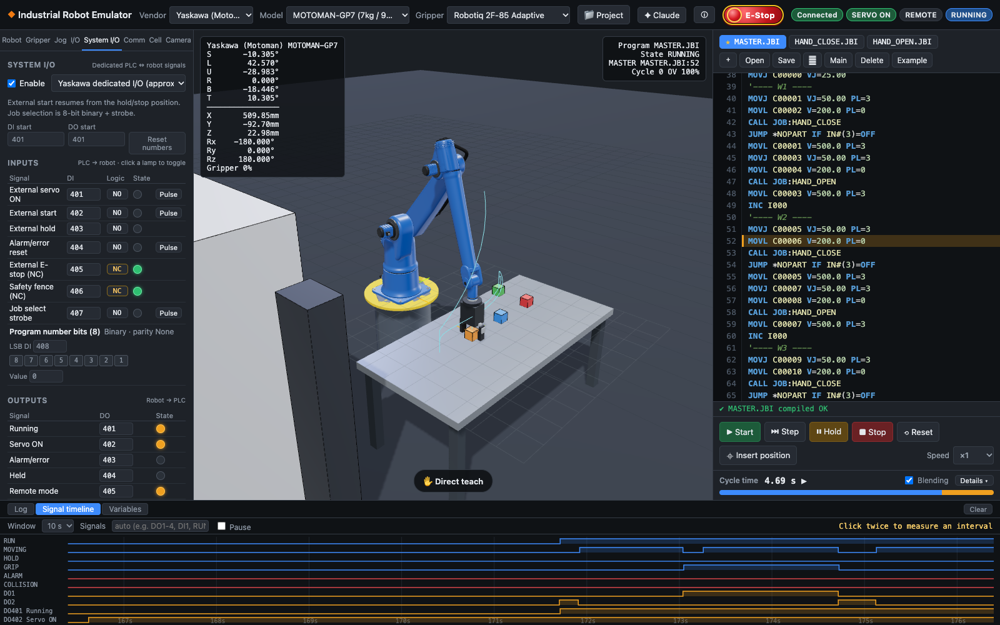
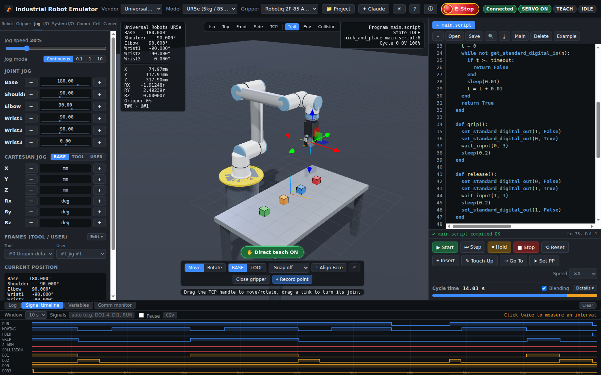
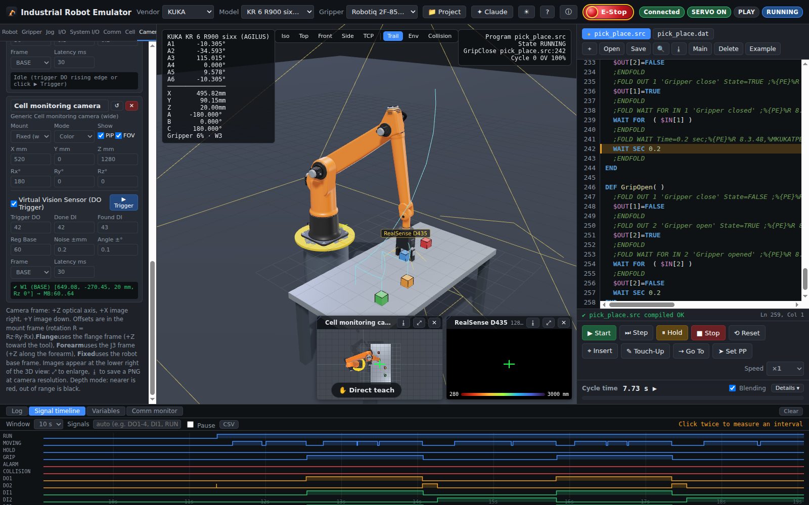
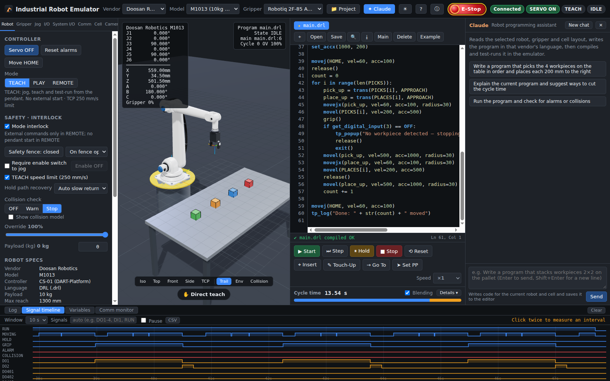
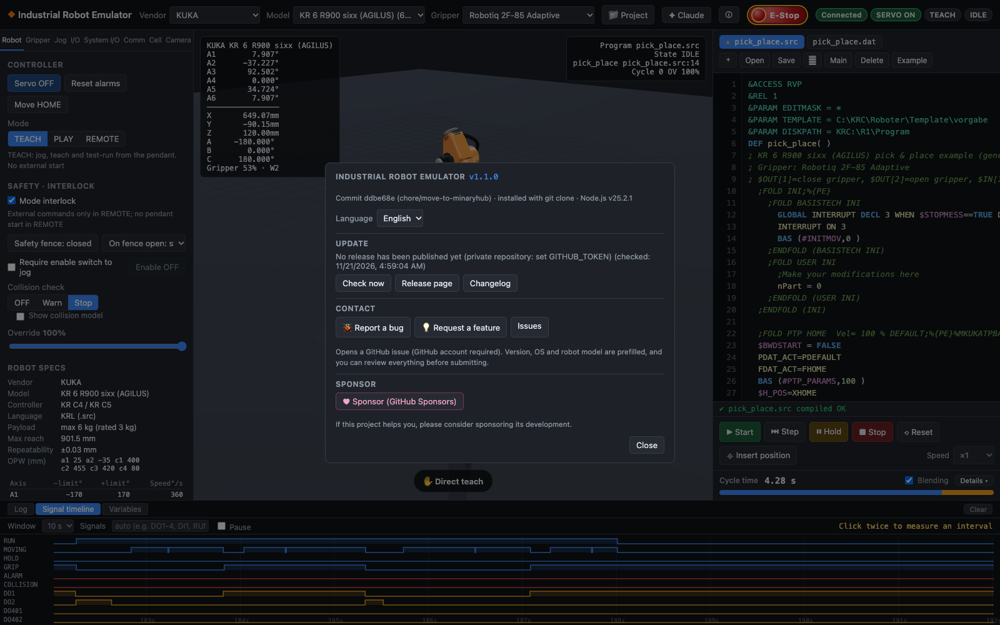

# Industrial Robot Emulator

**English** | [한국어](README.ko.md)

A virtual robot controller that emulates Yaskawa, Kawasaki, Hyundai, ABB, KUKA, Doosan Robotics and Universal Robots arms in one place.

- Run programs written in each vendor's own robot language as they are, and watch the motion in 3D.
- Talk to the emulator over each vendor's external interface, so you can develop and test PLC and host-PC software without a real robot.
- Runs in the browser on Windows, macOS and Linux. No native build, no vendor software.

**Docs** (Korean): [User manual](docs/MANUAL.md) · [SI roadmap](docs/ROADMAP-SI.md) · [Developer contract](docs/DEV_CONTRACT.md) · [Changelog](CHANGELOG.md)

## Screenshots

The UI is available in English and Korean. It follows the browser language, and you can switch in the About (ⓘ) dialog or with `?lang=en` / `?lang=ko`.



| | |
|---|---|
|  **Cell layout** — conveyor, feeder and sensor preset (ABB RAPID) |  **System I/O** — PLC handshake signals, external start in REMOTE (Yaskawa INFORM) |
|  **Direct teach** — drag the TCP or a link (Universal Robots) |  **Vision cameras** — flange and fixed cameras with live previews |
|  **Claude chat** — write, compile and test-run programs (Doosan DRL) |  **About** — version, one-click update, contact, sponsor |

## Quick start

```bash
git clone https://github.com/MinaryHub/RobotEmulator
cd RobotEmulator
npm install
npm start          # http://localhost:3000
npm test           # full test suite (kinematics, all languages, protocols, fieldbus, UI i18n)
```

- **Requirements:** Node.js 20 or later. Install and run the same way on Windows, macOS and Linux.
- **Dependencies:** `three` (3D view), `ws` (WebSocket), `node-opcua` (OPC UA server), `@anthropic-ai/sdk` (Claude chat), `occt-import-js` (STEP/IGES import, WASM in the browser, LGPL-2.1, used unmodified as a separate file). All are pure JavaScript/WASM, so no compiler is needed.
- **Port and bind address:**

| Where | Example |
|---|---|
| macOS / Linux | `PORT=3100 HOST=127.0.0.1 npm start` |
| Windows PowerShell | `$env:PORT=3100; $env:HOST="127.0.0.1"; npm start` |
| Windows cmd | `set PORT=3100 && set HOST=127.0.0.1 && npm start` |
| Any | `config.json` in the project root (see below). Precedence: defaults < `config.json` < environment |

- **Tests:** run per file in parallel (default: CPU count, max 8). `TEST_JOBS=1` runs them one by one; `node test/run-all.js krl` runs only matching files. GitHub Actions runs them on Windows, macOS and Linux with Node 20 and 22 (`.github/workflows/test.yml`).

### Platform notes

- **Ports below 1024 (Linux, macOS):** a normal user cannot bind Kawasaki AS port 23 or Modbus port 502. The emulator then falls back to 10023 and 1502 and prints the actual port. If you need the original ports, run with admin rights, or on Linux use `sudo setcap 'cap_net_bind_service=+ep' "$(command -v node)"`.
- **Windows firewall:** Windows asks to allow Node.js network access on the first run. Allow it if other PCs or PLCs need to connect. With the default `127.0.0.1` binding no firewall exception is needed.
- **Stopping:** Ctrl+C (also Ctrl+Break on Windows), or SIGTERM under a service manager or container. The emulator autosaves and closes its ports on exit.

### Security

The web UI, `/api/cmd`, `/ws` and the protocol interfaces have **no authentication**, like a real controller on a factory network. Anyone who can connect can move the robot and change programs and projects.

- **Default binding:** `"host": "127.0.0.1"`, so only this PC can connect. The value applies to the web server and every protocol interface; set `protocols.<key>.host` to override one interface.
- **Allowing other PCs and PLCs:** set `"host": "0.0.0.0"` (or `HOST=0.0.0.0`). Use it only on a trusted network.
- **Browser protection:** `/api`, `/ws` and `/mcp` reject browser requests from other origins and from unknown host names (DNS rebinding), so a web page you visit cannot drive the robot. `/api/cmd` only accepts `Content-Type: application/json`.
- **Host names:** if you open the UI by host name instead of an IP address (for example `robot-pc.local`), add it to `"allowedHosts": ["robot-pc.local"]`.

## Versions and updates

The About (ⓘ) dialog shows the current version. Changes for each version are in [CHANGELOG.md](CHANGELOG.md).

### Automatic updates

The server checks GitHub releases at startup and every 24 hours. When a newer version exists, a **⬆ vX.Y.Z** button appears in the header.

- **Update and restart:** if you installed with `git clone`, this button does the following:
  1. Fetches the new release tag (`git fetch`).
  2. Fast-forwards the current branch to that tag.
  3. Runs `npm install` if dependencies changed.
  4. Restarts the server. Your work is autosaved and restored, and the page reloads by itself.
- **When updating is refused:** the button tells you why. If an update fails midway, the previous commit is restored.
  - A program is running.
  - There are uncommitted source changes.
  - Local commits prevent a fast-forward.
- **ZIP install:** you get the notice and a link to the release page; download the new version yourself.
- **Restart requirement:** automatic restart works when the server was started with `npm start`, which runs it through a launcher (`server/launcher.js`). `npm run serve` starts the server directly; restart it yourself after an update.
- **Settings (`update` in `config.json`):**

| Key | Default | Meaning |
|---|---|---|
| `enabled` | `true` | Check for new versions automatically (otherwise only with **Check now**) |
| `intervalHours` | `24` | Check interval |
| `allowApply` | `true` | `false` shows the notice but disables updating from the UI |
| `repo` | repository in `package.json` | GitHub repository `owner/name` to check |
| `sponsorUrl` | `funding` in `package.json` | Sponsor link (empty string hides the button) |

- **Private forks:** set `GITHUB_TOKEN` to a token with read access.
- **Privacy:** update checks send no user information.

### Making a release (maintainers)

1. **Bump the version:** on a feature branch, raise `version` in `package.json` and add a `## [X.Y.Z] - date` section to `CHANGELOG.md`, then merge the PR.
2. **Release:** on `main`, `git pull`, then run `npm run release` to check. If everything is fine, `npm run release -- --yes` creates tag `vX.Y.Z` and the GitHub release, with notes taken from the CHANGELOG section.

## Contact and sponsoring

- **Contact:** in the About dialog, **🐞 Report a bug** and **💡 Request a feature** open a GitHub issue with version, OS and robot model prefilled (GitHub account required). You can also open one directly in [Issues](https://github.com/MinaryHub/RobotEmulator/issues).
- **Sponsor:** if this project helps you, please support its development through [GitHub Sponsors](https://github.com/sponsors/MinaryHub).

## Features

| Area | Details |
|---|---|
| Robot models | 93 models from 7 vendors — Yaskawa 21 (GP4–GP250, AR arc welding, collaborative HC20DTP), Kawasaki 14 (RS003N–RS080N, RS015X), Hyundai 15 (HDF, HH and HDR series, 4–300 kg), ABB 9 (IRB 120–IRB 7600), KUKA 18 (AGILUS, CYBERTECH, IONTEC, QUANTEC, 3–240 kg), Doosan 8 (cobots M0609, M0617, M1013, M1509, H2017, H2515, A0509, A0912), Universal Robots 8 (UR3e, UR5e, UR7e, UR10e, UR12e, UR16e, UR20, UR30). Cross-checked against datasheets, drawings and ROS-Industrial/RoboDK data (sources in `source` of `shared/robots.js`) |
| Kinematics | Analytic OPW inverse kinematics (up to 8 solutions). UR uses a separate standard-DH analytic solver (up to 8 solutions) because its wrist axes do not intersect. Vendor joint signs and zero offsets and each vendor's orientation convention (Rx·Ry·Rz / O·A·T / quaternion / A·B·C / Doosan ZYZ A·B·C / UR rotation vector) |
| Motion | Joint, linear and circular interpolation. Trapezoidal acceleration, joint speed limits (automatic slow-down near singularities), override, HOLD, soft limit / unreachable / singularity alarms |
| Blending | Corner rounding per vendor: INFORM `PL`, AS `ACCURACY` (+`BREAK`), HRScript `A=`, RAPID zonedata (`z10`…, `\Z`, `fine`), KRL `C_PTP/C_DIS` and inline `CONT`, DRL `radius=` (mm), URScript `r=` (m). Toggle in the UI to compare |
| Simulation speed | ×0.1 to ×10 next to the run buttons (keys `-` / `+`). Motion, waits, timers, pulses and peripherals all run on the simulation clock, so paths, blending and cycle time stay the same at any speed. Jog is always real-time. REST/WS: `{"cmd":"timeScale","value":4}` |
| Cycle time | Measured on the simulation clock (HOLD excluded, independent of PC load), split into motion / wait / other, with the slowest lines and recent history. Optional automatic workpiece reset on every start |
| Collision check | Robot links and gripper approximated by capsules, checked every tick against the table, floor, pedestal, workpieces and the robot itself. Modes: OFF / Warn / Stop (alarm), with 3D highlighting and an optional collision-model view |
| 3D model import | Place machines, jigs and fences from CAD (STEP, IGES, STL, OBJ, GLB). Triangle-accurate collisions (BVH), workpieces rest on model tops, edit position, rotation, scale, units, up axis and opacity. Saved with the project |
| Programs | Web editor with syntax highlighting, current-line display and compile-error locations. Start, step, hold, stop, reset (Space: start / hold / resume), insert the current position, open and download files |
| Grippers | 15 built-in gripper models (below) plus custom STL grippers. Opened and closed by DO with closed / opened / part-present DI feedback. Picking, carrying and dropping workpieces is simulated |
| Direct teach | Drag the TCP handle in 3D to move or rotate (BASE/TOOL, snapping), drag a link to turn its joint, undo, toggle the gripper, record with `Enter`. Unreachable, singular or colliding targets are refused with a reason (`T` key) |
| Operation | Joint and Cartesian jog (BASE/TOOL), servo on/off, mode switching, forced outputs and simulated inputs, I/O labels (CSV import/export), 3D work envelope (wrist-center reach) |
| Mode interlock and safety | External (PLC/PC) commands only in REMOTE, no pendant start in REMOTE, mode changes only from the screen. E-stop (stop category 0), safety fence (category 1/2), enable switch. Rejection reason codes are reported over Modbus, OPC UA and each protocol |
| System I/O | Dedicated I/O presets per vendor (generic, Yaskawa, KUKA Automatic External, ABB System I/O, Kawasaki, Hyundai, Doosan, UR): external servo on, start, hold, stop, reset, program number (8 bits + strobe + parity), running / alarm / home / cycle-complete outputs |
| Debugging | Click a line number for a breakpoint, variable watch (locals, globals, registers, change highlighting), signal timeline (DO/DI, RUN, MOVING, HOLD, GRIP, ALARM waveforms; click two points to measure Δt) |
| Projects | Save and load robot, gripper, settings, per-vendor programs and variables and the cell layout as `projects/<name>.json`; JSON export and import. Autosave every 2 seconds restores the last session after a restart (`"restoreSession": false` in `config.json` turns it off). Switching vendors and back keeps the previous program |
| Vision cameras | Mount 7 camera types (2D machine vision, smart camera, RealSense D435, Zivid 2+ M70, ToF, cell monitoring) on the flange, the forearm (J3) or a fixed position. Live camera views at the lower right of the 3D view (color / mono / depth colormap), view frustums, PNG capture at camera resolution. Saved with the project |
| Claude integration | The ✦ Claude chat writes, edits, compiles and test-runs programs for the current robot and cell, and can drive the servo, motion, gripper and I/O on request. The same tools are available as an MCP server (`/mcp`) for Claude Code and Claude Desktop (see below) |
| Cell layout | Place and edit tables, obstacles, workpieces and peripherals (conveyor, feeder, sensor, pneumatic cylinder, outlet, pallet) in the Cell tab. 6 presets (default, conveyor pick & place, machine tending (CNC), two-table transfer, outfeed conveyor, fenced cell), JSON export/import. Devices are wired to robot DI/DO (default DO9 conveyor run, DI9 arrival sensor), so they are visible over Modbus and OPC UA too. Obstacles and conveyor frames take part in collision checks |
| Languages (UI) | English and Korean. In English, newly generated example programs and cell preset names are English too; server log and alarm messages are still Korean |

## Supported robot languages

Selecting a robot generates a pick & place example that matches the current cell. The same examples are in [examples/](examples/).

| Vendor | Language | Files | Main coverage |
|---|---|---|---|
| Yaskawa | INFORM | `.JBI` | MOVJ/L/C/S, IMOV, DOUT, WAIT, JUMP/CALL, B·I·D·R·P variables, PULSE and RECTAN positions |
| Kawasaki | AS | `.as` / `.pg` | JMOVE/LMOVE, APPRO/DEPART, C1/C2MOVE, SIGNAL/SWAIT, IF·WHILE·FOR·CASE, transformation arithmetic, `.TRANS` / `.JOINTS` |
| Hyundai | HRScript | `.job` | MOVE P/L/C, DO/DI, WAIT, IF·FOR·WHILE, CALL, V variables, pose arithmetic |
| ABB | RAPID | `.mod` | MoveJ/L/C/AbsJ, Offs/RelTool, SetDO/WaitDI, PROC/FUNC, TEST, records and arrays, confdata |
| KUKA | KRL | `.src` + `.dat` | PTP/LIN/CIRC, inline forms (PDAT/LDAT), `:` operator, S/T, $OUT/$IN, SWITCH·LOOP·REPEAT |
| Doosan | DRL (Python syntax) | `.drl` / `.py` | movej/movel/movec/movejx/movesx, posj·posx·trans·fkin·ikin, set_digital_output·wait_digital_input, def·if·while·for, lists and f-strings, sub_program_run, TCP sockets (server/client_socket_*) |
| Universal Robots | URScript | `.script` | movej/movel/movep/movec (m·rad, a·v·t·r), p[…] poses, pose_trans·pose_add·get_inverse_kin·get_forward_kin, set_tcp, standard / configurable / tool digital I/O, def·if·elif·while … end, global/local, textmsg·popup, socket_* |

The detailed syntax supported for each language is described at the top of its module (`server/lang/*.js`).

## Claude integration (chat and MCP)

The web chat and the MCP server share the same 11 tools (`server/ai/tools.js`).

| Tool | What it does |
|---|---|
| `get_context` | Robot, language, gripper I/O, current pose, cell layout (workpiece, table and device coordinates), cameras, program state |
| `get_language_guide` | Summary of the vendor language as supported, plus a working example generated for the current cell |
| `read_program` / `write_program` | Read / save and compile controller files (shown in the editor immediately, compile errors returned) |
| `run_program` | start · step · stop · reset · reset_alarms · status — returns cycle time, alarms, collisions, workpiece positions and logs (only the virtual robot moves) |
| `get_logs` | Controller log |
| `set_servo` | Servo on/off (optionally reset alarms first) |
| `move_robot` | Move the virtual robot: home / joint angles / relative joints / absolute TCP (vendor notation) / relative TCP (BASE or TOOL), joint or linear, speed %. Waits for arrival and returns joints, TCP, alarms and collisions |
| `gripper` | Open or close the gripper (drives the gripper DO, updates feedback DI and picking) |
| `set_io` | Set DO outputs, simulate DI inputs |
| `stop_robot` | hold · resume · stop (cancel motion + stop program) · status |

Commands that move the robot (servo on, `move_robot`, `run_program` start/step, `stop_robot` resume, `gripper`, `set_io`) count as **external commands**, like a PLC or host PC, so they are allowed **only in REMOTE mode**. The mode can only be changed on the screen; turning off the mode interlock lifts the restriction. E-stop and the safety fence always apply, and direct moves are refused while a program runs. Writing and compiling programs, reading state and I/O, stop, HOLD and servo off work in any mode. Example prompts: "Turn the servo on and raise Z by 50 mm", "Go above W1 and close the gripper".

**Web chat** (✦ Claude in the header) connects to Claude in one of two ways. The default (`"backend": "auto"`) uses the Claude API when an API key is set in the environment and Claude Code otherwise.

| Backend | Authentication | Setup |
|---|---|---|
| Claude Code (`claude-code`) | The Claude Code login on this PC (a Claude Pro or Max subscription, for example). **No API key needed** | Install Claude Code → run `claude` in a terminal and log in → `npm start` |
| Claude API (`api`) | `ANTHROPIC_API_KEY` or `ant auth login` | See below |

To force one, set `"ai": { "backend": "claude-code" }` in `config.json`, or `AI_BACKEND=claude-code` / `AI_BACKEND=api`. The Claude Code backend runs `claude -p` for each request and gives it only this server's `/mcp` tools (no file or shell tools). The model comes from `"cliModel"` (Claude Code's default if omitted) and the effort level from `"effort"`.

Authentication for the Claude API backend:

| Method | Example |
|---|---|
| macOS / Linux | `ANTHROPIC_API_KEY=sk-ant-... npm start` |
| Windows PowerShell | `$env:ANTHROPIC_API_KEY="sk-ant-..."; npm start` |
| Anthropic CLI profile | `ant auth login`, then `npm start` (no environment variable needed) |

Change the model with `"ai": { "model": "claude-opus-5-5", "effort": "high" }` in `config.json`. On a refusal the request is retried with the server-side fallback model (`fallbacks: "default"`); `"fallbacks": false` turns that off. Each browser tab (WebSocket connection) keeps its own conversation, which starts fresh after a server restart or reconnect.

**MCP server:** keep the emulator running and register it with your MCP client. No credentials are needed (Claude runs in the client).

```bash
# Claude Code (Streamable HTTP)
claude mcp add --transport http robot-emulator http://localhost:3000/mcp
```

Clients that only support stdio (such as Claude Desktop) use the bridge — `claude_desktop_config.json`:

```json
{ "mcpServers": { "robot-emulator": { "command": "node", "args": ["C:/path/to/RobotEmulator/tools/mcp-stdio.js", "http://localhost:3000/mcp"] } } }
```

`/mcp` has no authentication either; as described under [Security](#security), use it only on a trusted network (browser requests from other origins are blocked).

## External interfaces

| Vendor | Protocol | Default port | Supported |
|---|---|---|---|
| Yaskawa | High-Speed Ethernet Server (UDP) | 10040 / 10041 | Status, position and alarm queries, IO, B/I/D/R/S/P variables, servo and hold, job select and start, motion commands (0x8A/0x8B), file transfer |
| Kawasaki | AS terminal (Telnet) | 23 (10023 as fallback) | WHERE, ZPOW, EXECUTE, HOLD/CONTINUE, DO, LOAD/SAVE |
| Hyundai | Hi6 Open API style REST | 8888 | Position, status, IO, variables, program control, motion |
| ABB | Robot Web Services 1.0/2.0 | 8080 | jointtarget and robtarget, RAPID execution, loadmod and symbols, IO signals, file service, subscriptions (WebSocket) |
| KUKA | KukaVarProxy / OpenShowVar | 7000 | Read/write $AXIS_ACT, $POS_ACT, $OV_PRO, $OUT/$IN and .dat global variables |
| Universal Robots | Dashboard Server (TCP text) | 29999 | load, play, stop, pause, programState, robotmode, power on, brake release, unlock protective stop, safetystatus, get robot model and more (UR-style replies) |
| Doosan | DRL sockets (opened by the program) | Set in the program | TCP with PCs and vision systems through `server_socket_open(port)` / `client_socket_open(ip, port)`; binds according to the `host` setting. For anything else use the common Modbus TCP and OPC UA servers |
| Common | REST / WebSocket | 3000 | `GET /api/state`, `POST /api/cmd`, `ws://…/ws` |
| Common (AI) | MCP (Streamable HTTP) | 3000 | `http://<host>:3000/mcp` — program generation and checking plus direct control tools (see Claude integration) |
| Common (fieldbus) | Modbus TCP server | 502 (1502 as fallback) | Coils = DI, discrete inputs = DO, status / joint / TCP / cycle-time input registers, command / override / user holding registers |
| Common (fieldbus) | OPC UA server (node-opcua) | 4840 | `opc.tcp://<host>:4840/UA/RobotEmulator`, status, joints, TCP, IO and register variables, subscriptions, control methods |

- Sample clients are in [tools/clients/](tools/clients/), for example `node tools/clients/kuka-varproxy-client.js 127.0.0.1`.
- Change ports with a `config.json` in the project root (omitted keys keep their defaults):

```json
{ "httpPort": 3000, "host": "127.0.0.1", "robot": "kuka-kr6-r900", "gripper": "robotiq-2f85",
  "protocols": { "abbRws": { "port": 80 }, "kawasakiAs": { "enabled": false }, "opcua": { "enabled": false } } }
```

### Modbus TCP address map

`server/protocols/modbus-tcp.js` — a Modbus TCP server with no external dependencies. The unit ID is ignored (echoed back) and multiple clients are supported. Function codes 01, 02, 03, 04, 05, 06, 15, 16 and 23; exceptions 01 (function), 02 (address), 03 (value). Addresses are **zero-based** (5-digit notation 40001 = holding 0). 32-bit values use two registers, **high word first**; int32 values are signed.

| Area | Address | Content | Access |
|---|---|---|---|
| Coil | 0..511 | Robot DI 1..512 (PLC → robot inputs, `ctrl.setDI/getDI`) | R/W |
| Discrete input | 0..511 | Robot DO 1..512 | R |
| Input reg | 0 | Status bits: b0 servo on, b1 program running, b2 HOLD, b3 alarm, b4 moving, b5 TEACH, b6 PLAY, b7 REMOTE, b8 program done, b9 program error, b10 collision, b11 E-stop, b12 safety fence open, b13 mode interlock on, b14 System I/O enabled | R |
| Input reg | 1 | Override % | R |
| Input reg | 2 | Number of alarms | R |
| Input reg | 3 | Last alarm code (numeric code or 16-bit hash, 0 if none) | R |
| Input reg | 4-5 | Program cycle count (u32) | R |
| Input reg | 6 | Vendor code: 1 Yaskawa, 2 Kawasaki, 3 Hyundai, 4 ABB, 5 KUKA, 6 Doosan, 7 UR (UR orientation is the rotation vector in rad × 1000) | R |
| Input reg | 7 | Last command rejection code (0 none, 1 not REMOTE, 3 E-stop … — [manual 9.2](docs/MANUAL.md#92-안전--모드-인터록)) | R |
| Input reg | 8 | Last latched program number (System I/O) | R |
| Input reg | 10..21 | J1..J6 (int32, deg × 1000) | R |
| Input reg | 30..43 | TCP pose `vendorPose()` as 7 × int32: X, Y, Z (mm × 1000) and 3 angles (deg × 1000); ABB uses q1..q4 (× 1,000,000, 36..43), otherwise 42-43 = 0 | R |
| Input reg | 50-51 | Last cycle time in ms (u32) | R |
| Input reg | 52-53 | Elapsed time of the current cycle in ms (u32) | R |
| Input reg | 60 | Gripper position % (0 open … 100 closed) | R |
| Input reg | 61 | Holding a workpiece (1/0) | R |
| Holding reg | 0 | Command: 1 servo on, 2 servo off, 3 start, 4 HOLD, 5 resume, 6 stop, 7 reset alarms, 8 reset program, 9 move home (a write runs it once; a read returns the last code) | R/W |
| Holding reg | 1 | Override % (1–100) | R/W |
| Holding reg | 2 | Last command result (0 OK, 1 rejected — reason in input reg 7) | R |
| Holding reg | 100..355 | User registers `MB:<n>` in `ctrl.regs` (n = address − 100), int16 — shared with robot programs and OPC UA | R/W |

Undefined input registers in 0..99 read 0; holding registers 3..99 are reserved (writes raise exception 02).

### OPC UA address space

`server/protocols/opcua.js` — endpoint `opc.tcp://<host>:4840/UA/RobotEmulator`, security None with anonymous access (Basic256Sha256 Sign/SignAndEncrypt also available; client certificates are trusted automatically). A self-signed server certificate is created in `.opcua-pki/` on first start. Namespace `urn:robot-emulator`, NodeId `ns=<idx>;s=Robot.<name>`.

| Node (Objects/Robot/…) | Type | Access |
|---|---|---|
| Vendor, Model, Controller | String | R |
| Servo | Boolean | R/W (`setServo`) |
| Mode | String (TEACH/PLAY/REMOTE) | R (W only with the mode interlock off) |
| Override | Double (%) | R/W |
| Moving, Held, AlarmActive | Boolean | R |
| EStop, FenceOpen, Interlock | Boolean | R |
| LastRejectCode / LastRejectReason | Int32 / String | R |
| ProgramNumber | Int32 (number latched by System I/O) | R |
| Alarms | String[] | R |
| ProgramName, ProgramStatus | String | R |
| CurrentLine / CycleCount | Int32 / UInt32 | R |
| LastCycleTime, CurrentCycleTime | Double (s) | R |
| Joints / JointNames | Double[6] (deg) / String[6] | R |
| TcpPose / TcpPoseNames | Double[] (vendor notation) / String[] | R |
| GripperPosition / HoldingPart | Double 0..1 / String | R |
| IO/DO, IO/DI | Boolean[512] (index 0 = signal 1) | R / R/W |
| IO/DO_1..DO_64, IO/DI_1..DI_64 | Boolean | R / R/W |
| Registers/MB_0..MB_63 | Int16 (`ctrl.regs` `MB:n`, same as Modbus holding 100..163) | R/W |
| Methods ServoOn, ServoOff, Start, Stop, Hold, Resume, ResetAlarms, ResetProgram, MoveHome, MoveJoints(Double[6] joints, Double speedFraction), SelectProgram(String name) | Outputs Ok (Boolean), Message (String) | Call |

All variables are bound to live values; subscriptions report changes with a minimum sampling interval of 100 ms. Samples: `node tools/clients/modbus-client.js 127.0.0.1 502`, `node tools/clients/opcua-client.js opc.tcp://127.0.0.1:4840/UA/RobotEmulator`.

## Gripper library

Shape models based on the outer dimensions and TCP from each maker's public specs ([shared/grippers.js](shared/grippers.js)).

- **Robotiq:** 2F-85, 2F-140, Hand-E, 3-Finger
- **OnRobot:** RG2, RG6, VGC10, MG10
- **SCHUNK:** PGN-plus-P 100, EGP 40
- **Zimmer:** GEP2016
- **Generic:** vacuum cup Ø40, 2×2 vacuum array, 22° MIG torch, spindle

You can also load an STL file and set its TCP.

Default I/O convention (changeable in the UI):

| Signal | Meaning |
|---|---|
| DO1 ON | Close / vacuum on |
| DO1 OFF or DO2 ON | Open |
| DI1 | Closed |
| DI2 | Opened |
| DI3 | Part present |

## Accuracy notes

- **Robot dimensions and speeds:** dimensions (OPW parameters), joint limits and speeds are approximations from public catalogs. If you need paths identical to real equipment, update [shared/robots.js](shared/robots.js) with the values from the vendor drawings.
  - Check the dimensions, joint signs and zero offsets (`offsets`/`signs`) of the Kawasaki and Hyundai models in particular.
  - Yaskawa `pulsePerDeg` depends on controller parameters.
  - Doosan models use the official URDF dimensions as is. Repeatability and A-series payload still need confirmation because the column alignment in the manual's spec table is unclear.
  - UR models use UR's official DH table and datasheets (2026-10: UR3e, UR7e, UR12e, UR20, UR30). Joint and TCP speeds for UR5e, UR10e and UR16e are estimated from the arms of the same size. Infinite wrist 3 rotation (UR3e) is limited to ±360°.
- **Blending:** the deceleration of one segment and the acceleration of the next are overlapped in joint space, so corner paths can differ somewhat from a real controller.
  - Level-to-radius conversions are estimates for default parameters: INFORM PL1–8 = 12.5–500 mm, HRScript A1–7 = 10–300 mm. Adjust `PL_MM` in `server/lang/inform.js` and `ACC_MM` in `hrscript.js` to match your site parameters.
- **URScript:** threads (thread/run/join), structs and matrices, RTDE register functions and force control are not supported. Acceleration `a` is ignored and `movep` runs as `movel`. PolyScope programs (`.urp`) are not read, so Dashboard `load x.urp` picks the `.script` with the same name. RTDE (30004) and Primary/Secondary (30001–30003) interfaces are not available yet.
- **DRL:** a subset of Python used in robot programs. Dictionaries, classes, `try` and external modules are not supported.
  - User functions and waiting functions (`movel`, `wait_digital_input`, …) inside an expression run before the rest of that expression; short-circuit `and`/`or`/conditional expressions are respected.
  - `amove*` (asynchronous moves) run synchronously, `movejx` ignores `sol` and uses the nearest solution, and `movesx`/`movesj` are approximated by blended via points. `acc` is ignored.
- **Payload:** effects of payload on acceleration are not modeled.
- **Collision check:** capsule approximations can differ from the real shape by a few mm to a few tens of mm.
  - For gripping, gripper ↔ workpiece contact and the last 5 mm at the TCP are excluded.
- **Protocols:** implemented from the manuals, but some parts could not be checked against the originals offline.
  - Verify the Hyundai Hi6 Open API paths and the Yaskawa HSE added status codes against the real manuals.
  - Known differences are listed at the top of each protocol file.

## Project layout

```
shared/            kinematics (OPW), math, robot and gripper libraries, pose notation, UI translation engine (server + browser)
server/            controller.js (virtual controller), motion.js (trajectories), vm.js (program VM), index.js (HTTP/WS), updater.js, launcher.js
server/lang/       language compilers: inform, as, hrscript, rapid, krl, drl, urscript (+ shared expression parser expr.js; drl/urscript have their own parsers)
server/protocols/  vendor protocol servers + fieldbus (Modbus TCP, OPC UA)
server/ai/         Claude chat and MCP tools
public/            web UI (Three.js 3D view, editor, panels, i18n)
tools/             sample protocol clients, example export, release script
test/              automated tests (run-all.js runs *.test.js in parallel)
docs/MANUAL.md        user manual (Korean)
docs/ROADMAP-SI.md    roadmap for SI sites (PLC and host-PC developers)
docs/DEV_CONTRACT.md  contract for language and protocol modules (read before adding a vendor or language)
```
